  <a href="https://aamaliche.com/en/">
    <picture>
      <source media="(prefers-color-scheme: dark)" srcset="dark_mode.svg">
      
    </picture>
  </a>

I build automations, AI assistants and .NET applications. I start by understanding how a business works, then I automate its repetitive tasks, with AI when rules are no longer enough.

[Portfolio: aamaliche.com](https://aamaliche.com/en/) · [Upwork](https://www.upwork.com/freelancers/~0169f06e9faed57636) · [LinkedIn](https://www.linkedin.com/in/Mimid-aamaliche) · mohamed@aamaliche.com

## What I build

**Ask your documents.** A Python assistant that answers from your own documents (RAG) and says when it does not have the information. The model can be online or local with Ollama. Example: [AI assistant on Moroccan law](https://aamaliche.com/en/projects/moroccan-law-assistant/), personal project.

**From voice to PDF report.** Local audio transcription with Whisper, then a PDF report produced automatically from the entered data. Example: [Smart patient record](https://aamaliche.com/en/projects/smart-patient-record/), client project.

**A .NET application.** An ASP.NET Core API, a SQL Server or PostgreSQL database and a React interface, from the API to the screen. Example: [School Net](https://aamaliche.com/en/projects/school-net/), personal project.

## Projects

Each project is shown with its exact status: personal, academic or client. I never pass an exercise off as an assignment.

| Project | Status | Stack |
| --- | --- | --- |
| [AI assistant on Moroccan law](https://aamaliche.com/en/projects/moroccan-law-assistant/) | Personal project | Python, FastAPI, Ollama, LangChain, ChromaDB |
| [Smart patient record](https://aamaliche.com/en/projects/smart-patient-record/) | Client project | Java, Spring Boot, Thymeleaf, LaTeX, pdflatex, MinIO, Whisper |
| [School Net, an online course platform](https://aamaliche.com/en/projects/school-net/) | Personal project | ASP.NET Core 8, React 19, TypeScript, SQL Server, Stripe, Mux |
| [Real-time data tracking](https://aamaliche.com/en/projects/real-time-data-tracking/) | Client project | .NET, PostgreSQL, Entity Framework |

Each project has its own page, with the details, in my [portfolio](https://aamaliche.com/en/projects/).

## Education and experience

- **École Nationale des Sciences Appliquées d'Oujda:** engineering programme in software engineering and artificial intelligence, 2022 to 2027.
- **Summer internship at YoSoBox,** 17 July – 17 September 2026: QA tester on an application under development. Development of the e-commerce shop on WordPress.

Français

Je construis des automatisations, des assistants IA et des applications .NET. Je commence par comprendre comment une entreprise travaille, puis j'automatise ses tâches répétitives, avec l'IA quand les règles ne suffisent plus.

[Portfolio&nbsp;: aamaliche.com](https://aamaliche.com/) · [Upwork](https://www.upwork.com/freelancers/~0169f06e9faed57636) · [LinkedIn](https://www.linkedin.com/in/Mimid-aamaliche) · mohamed@aamaliche.com

## Ce que je construis

**Interroger vos documents.** Un assistant en Python qui répond à partir de vos propres documents (RAG) et qui dit quand il n'a pas l'information. Le modèle peut être en ligne ou local avec Ollama. Exemple&nbsp;: [Assistant IA en droit marocain](https://aamaliche.com/projets/assistant-droit-marocain/), projet personnel.

**De la voix au rapport PDF.** Une transcription audio en local avec Whisper, puis un rapport PDF produit automatiquement à partir des données saisies. Exemple&nbsp;: [Dossier patient intelligent](https://aamaliche.com/projets/dossier-patient-intelligent/), projet client.

**Une application .NET.** Une API ASP.NET Core, une base SQL Server ou PostgreSQL et une interface React, de l'API à l'écran. Exemple&nbsp;: [School Net](https://aamaliche.com/projets/school-net/), projet personnel.

## Projets

Chaque projet est présenté avec son statut exact&nbsp;: personnel, académique ou client. Je ne fais jamais passer un exercice pour une mission.

| Projet | Statut | Technologies |
| --- | --- | --- |
| [Assistant IA en droit marocain](https://aamaliche.com/projets/assistant-droit-marocain/) | Projet personnel | Python, FastAPI, Ollama, LangChain, ChromaDB |
| [Dossier patient intelligent](https://aamaliche.com/projets/dossier-patient-intelligent/) | Projet client | Java, Spring Boot, Thymeleaf, LaTeX, pdflatex, MinIO, Whisper |
| [School Net, plateforme de cours en ligne](https://aamaliche.com/projets/school-net/) | Projet personnel | ASP.NET Core 8, React 19, TypeScript, SQL Server, Stripe, Mux |
| [Suivi de données en temps réel](https://aamaliche.com/projets/suivi-donnees-temps-reel/) | Projet client | .NET, PostgreSQL, Entity Framework |

Chaque projet a sa propre page, avec le détail, dans mon [portfolio](https://aamaliche.com/projets/).

## Formation et expérience

- **École Nationale des Sciences Appliquées d'Oujda&nbsp;:** cycle ingénieur en génie logiciel et intelligence artificielle, 2022 à 2027.
- **Stage d'été chez YoSoBox,** du 17 juillet au 17 septembre 2026&nbsp;: testeur QA sur une application en cours de développement. Développement de la boutique e-commerce sous WordPress.

